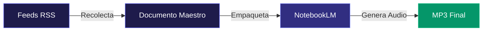
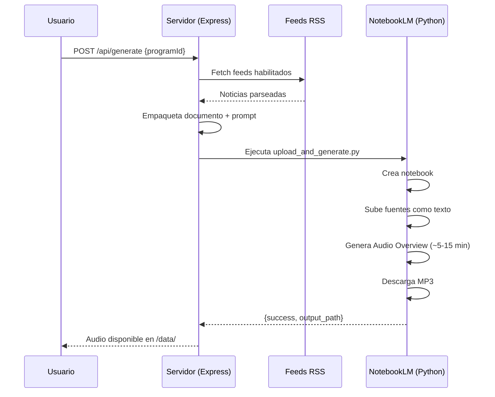
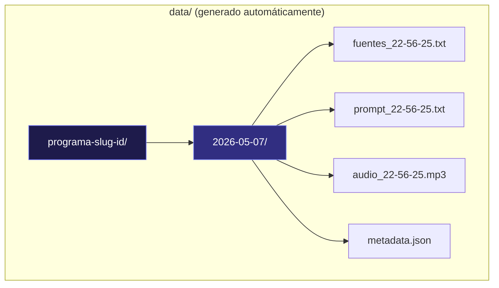

# Zifk

> **Bucea profundo. Informa al instante.**

*Inspirado en el Zifio — el mamífero marino de inmersiones profundas y ciclos de tiempo estrictos.*

Plataforma web que automatiza la creación de **programas radiales de noticias con IA**. Define múltiples programas con personalidad propia, fuentes RSS y locutores virtuales — y genera podcasts profesionales con un solo clic usando **Google NotebookLM** como motor de voz.

---

## ¿Qué hace?



1. **Recolecta** noticias en tiempo real de feeds RSS configurados por programa
2. **Empaqueta** un documento maestro con los artículos priorizados
3. **Sube** automáticamente a Google NotebookLM
4. **Genera** un Audio Overview con voces naturales de IA
5. **Descarga** el MP3 final listo para transmisión o distribución

---

## Pipeline completo



---

## Funcionalidades

| Feature | Descripción |
|---------|-------------|
| Multi-programa | Crea programas con radio, audiencia, slogan y locutores personalizados |
| Feeds configurables | Agrega/quita fuentes RSS por programa con prioridad |
| Buscador RSS (Gemini) | Describe un tema y la IA sugiere feeds verificados |
| Generación con progreso | Barra de progreso en tiempo real (collecting → packaging → generating) |
| Historial completo | Consulta generaciones previas, reproduce, descarga, ve fuentes y prompts |
| Reproductor flotante | Audio persiste al navegar entre páginas |
| Control de volumen | Persistente en localStorage |
| Recuperación de estado | Al recargar la página, recupera generaciones en curso |
| Onboarding guiado | Setup paso a paso para nuevos usuarios |

---

## Arquitectura

```
zifk/
├── public/
│   ├── index.html          # SPA (frontend completo)
│   └── logo.svg            # Marca Zifk
├── src/
│   ├── server.ts           # Express API + orquestación pipeline
│   ├── config.ts           # Gestión de configuración y prompts
│   ├── collect/
│   │   └── rss_parser.ts   # Parser RSS con fetch nativo
│   └── notebooklm/
│       ├── notebooklm_bridge.ts    # Bridge TS → Python (spawn)
│       ├── upload_and_generate.py  # Crea notebook, sube, genera, descarga
│       ├── download_audio.py       # Descarga audio de notebook existente
│       └── login_chrome.py         # Autenticación Google Chrome
├── data/                   # Generado: audios, fuentes, metadata (gitignored)
├── config.json             # Configuración local (gitignored)
├── .env                    # Variables de entorno (gitignored)
├── package.json
└── tsconfig.json
```

---

## Almacenamiento de datos



```
data/
└── {programa-id}/
    └── {YYYY-MM-DD}/
        ├── fuentes_{HH-MM-SS}.txt    # Documento con noticias empaquetadas
        ├── prompt_{HH-MM-SS}.txt     # Prompt de personalización del audio
        ├── audio_{HH-MM-SS}.mp3      # Audio final generado
        └── metadata.json             # Array con info de cada generación del día
```

Cada entrada en `metadata.json` contiene:
- Nombre del programa, idioma, timestamp
- Cantidad de noticias, feeds usados, speakers
- Duración del audio y tiempo de generación

---

## Instalación

### Pre-requisitos
- **Node.js** v18+
- **Python** 3.10+
- **Google Chrome** instalado (para autenticación NotebookLM)

### Setup

```bash
git clone https://github.com/tu-usuario/zifk.git
cd zifk
npm install
```

Dependencias Python:
```bash
pip install "notebooklm-py[browser]"
playwright install chromium
```

---

## Configuración

### Desde la interfaz web (recomendado)

```bash
npm run dev
```

Abre `http://localhost:3000`. El onboarding te guía para:
1. Configurar tu **API Key de Gemini** (gratis en [aistudio.google.com](https://aistudio.google.com/apikey))
2. Iniciar sesión en **NotebookLM** con tu cuenta de Google

### Manual

Crea `.env` en la raíz:
```env
GEMINI_API_KEY="tu_clave_gemini"
```

Para NotebookLM, ejecuta una vez:
```bash
npm run notebooklm:login
```
Se abrirá Chrome — inicia sesión con tu cuenta de Google.

---

## Uso

```bash
npm run dev
```

Abre `http://localhost:3000` → Selecciona un programa → **Generar**. El progreso se muestra en tiempo real (~5-15 min).

---

## API Endpoints

| Método | Ruta | Descripción |
|--------|------|-------------|
| GET | `/api/config` | Obtener configuración |
| PUT | `/api/config` | Actualizar configuración |
| GET | `/api/programs` | Listar programas |
| POST | `/api/programs` | Crear programa |
| PUT | `/api/programs/:id` | Editar programa |
| DELETE | `/api/programs/:id` | Eliminar programa |
| POST | `/api/generate` | Iniciar generación |
| GET | `/api/status` | Estado del pipeline |
| GET | `/api/history` | Historial de generaciones |
| POST | `/api/rss-finder` | Buscar feeds RSS con Gemini |
| GET | `/api/nlm-auth-status` | Estado de autenticación NLM |

---

## Stack Tecnológico

- **Backend:** Node.js + Express + TypeScript (ts-node)
- **Frontend:** HTML/CSS/JS vanilla (SPA, sin framework)
- **Motor de voz:** Google NotebookLM Audio Overview
- **IA auxiliar:** Google Gemini 2.5 Flash (buscador RSS)
- **RSS:** rss-parser + fetch nativo
- **Automatización NLM:** Python + notebooklm-py + Playwright

---

## Seguridad

- Claves API en `.env` (gitignored)
- `config.json` con datos de programas (gitignored)
- `data/` con audios generados (gitignored)
- Validación de feeds RSS: se verifica que cada URL sea XML válido antes de mostrarla
- Sin dependencias innecesarias

---

## Limitaciones conocidas

- **Voces de NotebookLM:** La asignación voz masculina/femenina a cada personaje no es 100% controlable — es una decisión interna de NotebookLM
- **Tiempo de generación:** 5-15 minutos por audio (limitación del servicio)
- **Sesión NLM:** La autenticación puede expirar, requiere re-login periódico
- **Concurrencia:** Solo una generación a la vez por instancia

---

## Autor

Desarrollado por **Emmanuel Salazar** ([@Ktol](https://github.com/Ktols))

---

## Licencia

ISC
